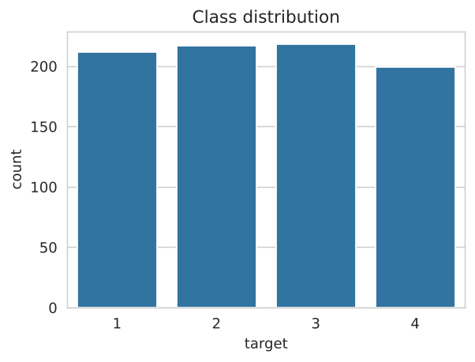
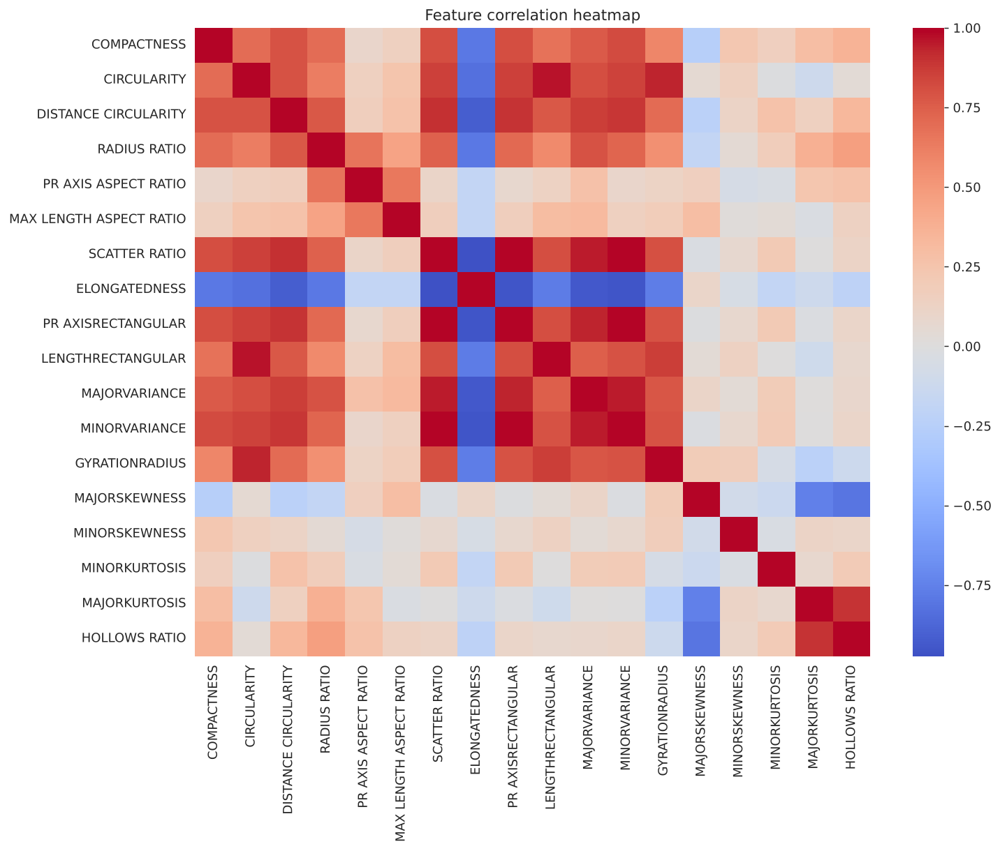
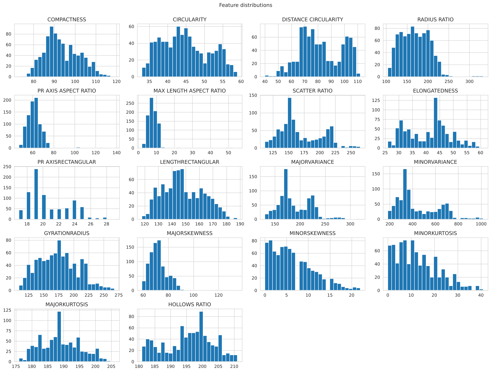
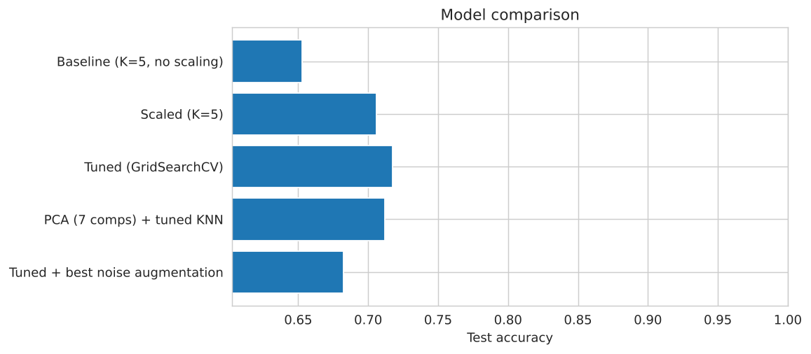
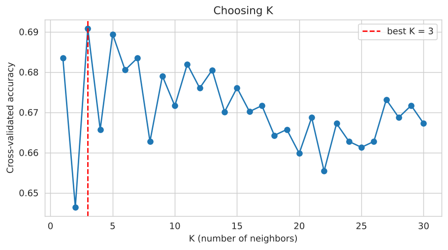
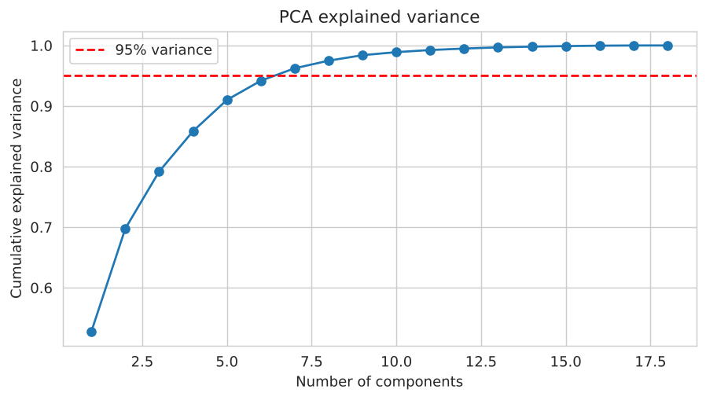
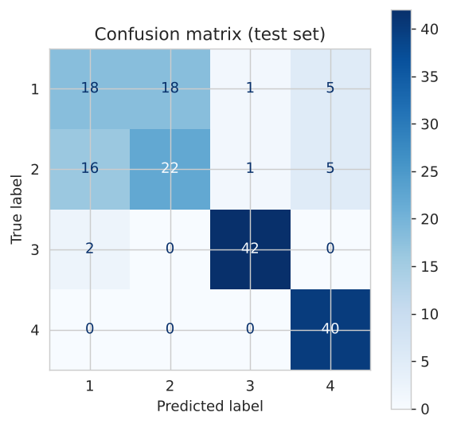
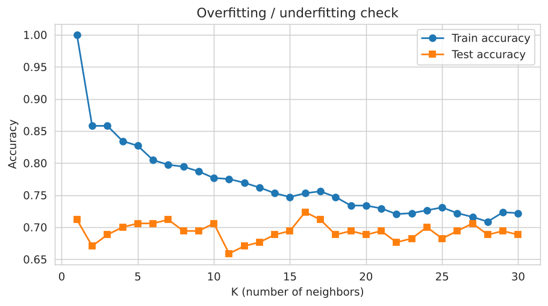
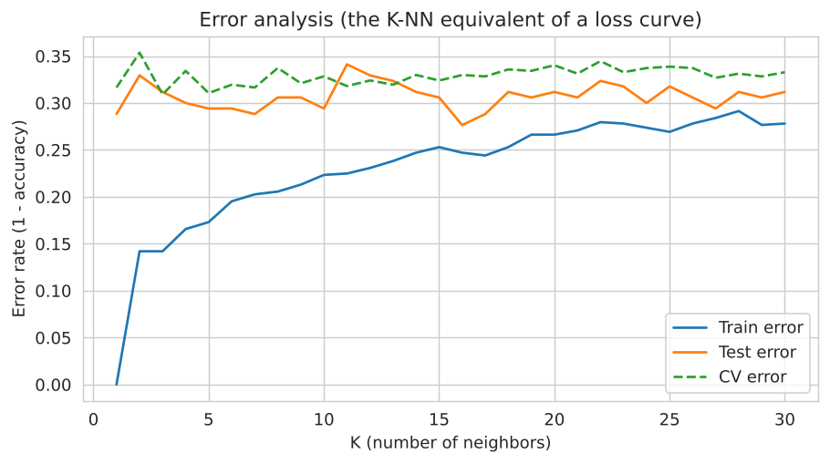

# Vehicle Silhouette Classification using K-Nearest Neighbors (K-NN)

> **Assignment 1: K-means or K-NN Algorithm Implementation**

> **Course:** Introduction to Machine Learning | **Instructor:** Kalpita Dutta | **Submission date:** 7.11.2026

[](https://colab.research.google.com/drive/1TrjFU_hu8jOK9p4syHejX0WG6ULTLTzy)


---

## Table of Contents

1. [Purpose of the Project](#1-purpose-of-the-project)
2. [Why K-NN and Not K-means?](#2-why-k-nn-and-not-k-means)
3. [Dataset](#3-dataset)
4. [How K-NN Works](#4-how-k-nn-works)
5. [Methodology (Step by Step)](#5-methodology-step-by-step)
6. [Optimization Techniques](#6-optimization-techniques)
7. [Results](#7-results)
8. [Overfitting / Underfitting Analysis](#8-overfitting--underfitting-analysis)
9. [Discussion and Limitations](#9-discussion-and-limitations)
10. [How to Run](#10-how-to-run)
11. [Repository Structure](#11-repository-structure)
12. [Team Members](#12-team-members)
13. [References](#13-references)

---

## 1. Purpose of the Project

The goal of this project is to **implement the K-Nearest Neighbors (K-NN) algorithm in Python (Google Colab) on a real-life dataset** and to **optimize it systematically**, measuring how much each technique improves performance.

The practical task is a **multi-class classification problem**: given 18 numerical measurements taken from the silhouette (outline) of a vehicle, predict which of 4 vehicle classes it belongs to.

The project demonstrates:

- the full machine learning workflow (explore, split, train, tune, evaluate);
- the effect of feature scaling, hyperparameter tuning, dimensionality reduction and data augmentation on K-NN;
- how to detect overfitting and underfitting;
- honest reporting of results, including techniques that did **not** help.

---

## 2. Why K-NN and Not K-means?

| | K-means | K-NN |
|---|---|---|
| Learning type | Unsupervised (finds groups) | Supervised (predicts a known label) |
| Needs labels? | No | Yes |
| Meaning of "K" | Number of clusters | Number of neighbors that vote |

Our dataset **has class labels** (`target`), so a supervised method is the natural fit. K-NN lets us measure real accuracy against the true labels, which makes optimization measurable and comparable. K-means would ignore the labels and could only be judged by indirect cluster-quality scores.

---

## 3. Dataset

- **Name:** Vehicle Silhouettes dataset (originally from the UCI Machine Learning Repository)
- **File:** `vehicle.csv`
- **Source link:** https://www.kaggle.com/datasets/patriciabrezeanu/statlog-vehicle-silhouettes
- **Size:** 846 samples x 19 columns (18 features + 1 label)
- **Missing values:** none
- **Task:** 4-class classification

**Features (all numeric, computed from the silhouette image):**
COMPACTNESS, CIRCULARITY, DISTANCE CIRCULARITY, RADIUS RATIO, PR AXIS ASPECT RATIO, MAX LENGTH ASPECT RATIO, SCATTER RATIO, ELONGATEDNESS, PR AXISRECTANGULAR, LENGTHRECTANGULAR, MAJORVARIANCE, MINORVARIANCE, GYRATIONRADIUS, MAJORSKEWNESS, MINORSKEWNESS, MINORKURTOSIS, MAJORKURTOSIS, HOLLOWS RATIO.

**Target:** `target` with classes `1, 2, 3, 4`. The classes are well balanced (about 200 to 218 samples each).



**Important observation:** feature ranges differ enormously. For example, `MINORVARIANCE` ranges from 184 to 1018, while `MINORSKEWNESS` ranges from 0 to 22. Since K-NN is based on distances, large-valued features would dominate the result unless the data is scaled. This motivated our scaling step.





---

## 4. How K-NN Works

K-NN is a "lazy" learning algorithm: it does not build a model during training, it simply stores the training data. To classify a new sample:

1. Compute the **distance** from the new sample to every training sample.
2. Select the **K closest** training samples (the "neighbors").
3. Let the neighbors **vote**; the most common class becomes the prediction.

Key settings (hyperparameters):

- **K (`n_neighbors`)**: how many neighbors vote. Small K gives flexible but noisy boundaries (risk of overfitting). Large K gives smooth but too simple boundaries (risk of underfitting).
- **Distance metric**: Euclidean (straight-line), Manhattan (sum of absolute differences) or Minkowski (generalization of both).
- **Weights**: `uniform` (all neighbors count equally) or `distance` (closer neighbors count more).

---

## 5. Methodology (Step by Step)

| Step | Description | Notebook section |
|---|---|---|
| 1 | Import libraries; fix `random_state = 42` for reproducibility | Cell 1 |
| 2 | Load `vehicle.csv`; check shape and missing values | Cell 2 |
| 3 | Exploratory data analysis: statistics, class balance, correlations, distributions | Cell 3 |
| 4 | Stratified 80/20 train/test split (676 train / 170 test) | Cell 4 |
| 5 | Baseline K-NN (K = 5, no scaling) | Cell 5 |
| 6 | Add `StandardScaler` inside a `Pipeline` (avoids data leakage) | Cell 6 |
| 7 | Choose K with 5-fold stratified cross-validation (K = 1 to 30) | Cell 7 |
| 8 | Overfitting/underfitting check: train vs. test accuracy for each K | Cell 8 |
| 9 | Hyperparameter tuning with `GridSearchCV` (K, weights, metric) | Cell 9 |
| 10 | Extra optimization: PCA dimensionality reduction | Cell 10 |
| 11 | Extra optimization: data augmentation with Gaussian noise (training data only) | Cell 11 |
| 12 | Error analysis (the K-NN equivalent of a loss curve) | Cell 12 |
| 13 | Final evaluation on the held-out test set | Cell 13 |
| 14 | Summary table and model comparison chart | Cell 14 |

**Design decisions worth noting:**

- **Stratified split:** each class appears in the same proportion in the training and test sets.
- **Pipeline:** the scaler is fitted only on training data inside each cross-validation fold, so no information from the test data leaks into training.
- **Test set used only for final reporting:** all tuning decisions (K, metric, weights) were made with cross-validation on the training set.

---

## 6. Optimization Techniques

The assignment lists several optimization techniques. Here is how each applies to K-NN.

| Technique from assignment | Applied? | What we did |
|---|---|---|
| **Hyperparameter tuning** | Yes | `GridSearchCV` over 30 values of K x 2 weighting schemes x 3 distance metrics (180 combinations, 5-fold CV each) |
| **Loss / accuracy analysis** | Yes | Accuracy and error rate (1 - accuracy) versus K for train, test and cross-validation |
| **Overfitting / underfitting checks** | Yes | Train vs. test accuracy curve and gap analysis across K |
| **Data augmentation** | Yes (tested) | Noisy copies of training rows at 3 noise levels (2%, 5%, 10% of each feature's standard deviation); applied to training data only |
| **Feature scaling** *(extra)* | Yes | `StandardScaler` |
| **Dimensionality reduction** *(extra)* | Yes | PCA keeping 95% of the variance |
| **Cross-validation** *(extra)* | Yes | 5-fold stratified CV for all model selection |
| **Optimizers / activation functions** | **Not applicable** | See the note below |

> **Note on optimizers and activation functions:** these concepts belong to models trained by gradient descent, such as neural networks. K-NN has no learnable weights, no differentiable loss function and no activation functions; it just stores the training data and compares distances at prediction time. Adding an optimizer or activation function to K-NN would be artificial and meaningless, so we did not do it. Instead, the equivalent kind of analysis for K-NN is **error analysis against K** and **hyperparameter search**, which we performed.

---

## 7. Results

All results below come from running the notebook with `random_state = 42`. Re-running it should give the same numbers (tiny differences are possible across library versions).

### 7.1 Model comparison

| # | Model | Test accuracy |
|---|---|---|
| 1 | Baseline (K = 5, no scaling) | **65.29%** |
| 2 | Scaled (K = 5, StandardScaler) | **70.59%** |
| 3 | Tuned with GridSearchCV | **71.76%** |
| 4 | PCA (7 components) + tuned K-NN | **71.18%** |
| 5 | Tuned + best noise augmentation | **68.24%** |



**Best model:** the tuned, scaled K-NN (row 3), with **71.76% test accuracy**, an improvement of **+6.47 percentage points** over the baseline.

### 7.2 Effect of each step

- **Feature scaling:** +5.29 points (65.29% to 70.59%). This was the single most effective step.
- **Hyperparameter tuning:** +1.17 points on top of scaling.
- **PCA:** reduced 18 features to 7 (95% of variance kept) with almost the same accuracy (71.18% vs. 71.76%). This gives a simpler model at nearly equal performance, but not a better one.
- **Data augmentation:** *decreased* accuracy (-3.5 to -4.7 points). Noisy copies blur the boundaries between classes that already overlap.

### 7.3 Choosing K

Cross-validation on the scaled data suggests small K values perform best (K = 3 gave 69.08% CV accuracy using plain Euclidean voting).



### 7.4 Hyperparameter tuning

Best parameters found by `GridSearchCV`:

| Hyperparameter | Best value |
|---|---|
| `n_neighbors` | 9 |
| `weights` | distance |
| `metric` | manhattan |
| Best CV accuracy | 71.01% |

Top 5 combinations (all Manhattan distance with distance weighting):

| K | Weights | Metric | Mean CV accuracy | Std |
|---|---|---|---|---|
| 9 | distance | manhattan | 0.7101 | 0.0331 |
| 21 | distance | manhattan | 0.7086 | 0.0243 |
| 25 | distance | manhattan | 0.7071 | 0.0262 |
| 7 | distance | manhattan | 0.7071 | 0.0266 |
| 19 | distance | manhattan | 0.7071 | 0.0235 |

The top five scores are very close, so the choice among them is not decisive; the consistent pattern is that **Manhattan distance with distance weighting** works best on this dataset.

### 7.5 PCA



7 principal components capture 95% of the variance of the 18 scaled features.

### 7.6 Final model evaluation (test set, 170 samples)

**Accuracy: 71.76%**

| Class | Precision | Recall | F1-score | Support |
|---|---|---|---|---|
| 1 | 0.50 | 0.43 | 0.46 | 42 |
| 2 | 0.55 | 0.50 | 0.52 | 44 |
| 3 | 0.95 | 0.95 | 0.95 | 44 |
| 4 | 0.80 | 1.00 | 0.89 | 40 |
| **Macro avg** | 0.70 | 0.72 | 0.71 | 170 |
| **Weighted avg** | 0.70 | 0.72 | 0.71 | 170 |

**Confusion matrix** (rows = true class, columns = predicted class):

| True \ Predicted | 1 | 2 | 3 | 4 |
|---|---|---|---|---|
| **1** | 18 | 18 | 1 | 5 |
| **2** | 16 | 22 | 1 | 5 |
| **3** | 2 | 0 | 42 | 0 |
| **4** | 0 | 0 | 0 | 40 |



**Reading the results:** classes 3 and 4 are recognized very reliably (F1 of 0.95 and 0.89). Almost all errors come from **classes 1 and 2 being confused with each other** (34 of the 48 misclassifications). Their silhouettes appear to be very similar in the measured features.

---

## 8. Overfitting / Underfitting Analysis

We compared training accuracy and test accuracy for K = 1 to 30.



| K | Train - Test accuracy gap | Interpretation |
|---|---|---|
| 1 | 0.288 | **Overfitting:** memorizes the training data (100% training accuracy) but generalizes poorly |
| 3 | 0.170 | Still a noticeable gap |
| 30 | 0.034 | Small gap; the model is smoother and more stable |

- At **small K**, the model fits the training data perfectly (training accuracy 100% at K = 1) but test accuracy is only about 71%: classic overfitting.
- As **K increases**, training accuracy falls steadily (100% at K = 1, about 79% at K = 9, about 72% at K = 30) and moves toward the test accuracy, so the gap shrinks. Test accuracy itself stays roughly flat, between about 69% and 71%.
- Because test accuracy does not fall noticeably up to K = 30, we see **no clear sign of underfitting** in this range. Underfitting would only appear for much larger K, when the vote becomes too general.



The error curves (the K-NN equivalent of a loss curve) show the same behavior: training error is zero at K = 1 and rises with K, while test error stays roughly constant (about 29% to 31%). The model therefore cannot be improved much by changing K alone, which is why the other techniques matter.

---

## 9. Discussion and Limitations

- **Scaling is essential for K-NN.** It gave the largest gain by far, because the raw features have very different ranges.
- **Tuning gave a modest gain.** The improvement from 70.59% to 71.76% is small, and with only 170 test samples one test sample is worth about 0.6 percentage points, so small differences between models should not be over-interpreted.
- **Augmentation did not help.** Adding Gaussian noise made the class overlap worse. We report this honestly instead of hiding it.
- **PCA** reduced model complexity (18 to 7 features) without a meaningful accuracy loss, which would matter for speed on larger datasets.
- **Hard classes.** Classes 1 and 2 overlap strongly in feature space. K-NN, which relies purely on distance, has a natural ceiling here.
- **Limitation of the augmentation comparison:** the best noise level in Cell 14 is picked by test accuracy; since augmentation was worse than the reference at every level, this does not change the conclusion.
- **Single split:** results come from one 80/20 split. Repeating with several random splits would give a more robust estimate.

**Possible future work:** try other classifiers for comparison (Random Forest, SVM), apply feature selection, and test class-specific features to separate classes 1 and 2.

---

## 10. How to Run

### Option A: Google Colab (recommended)

1. Click the **Open in Colab** badge at the top of this page (or open `notebook/vehicle_knn.ipynb` in Colab).
2. Run the cells from top to bottom (**Runtime > Run all**).

No file upload is needed. The dataset is loaded automatically from this repository, so just make sure you are connected to the internet.

### Option B: Run locally

```bash
git clone https://github.com/torchowl/vehicle-knn-classification
cd vehicle-knn-classification
pip install -r requirements.txt
jupyter notebook notebook/vehicle_knn.ipynb
```

Then run all the cells from top to bottom. The dataset is loaded automatically from this repository, so an internet connection is required.

### Requirements

```
numpy
pandas
matplotlib
seaborn
scikit-learn
```

---

## 11. Repository Structure

```
.
├── README.md                 # this file
├── requirements.txt          # Python dependencies
├── data/
│   └── vehicle.csv           # dataset
├── notebook/
│   └── vehicle_knn.ipynb     # Google Colab notebook
├── images/                   # plots used in this README
│   ├── class_distribution.png
│   ├── correlation_heatmap.png
│   ├── feature_distributions.png
│   ├── choosing_k_cv.png
│   ├── train_vs_test_accuracy.png
│   ├── pca_explained_variance.png
│   ├── error_analysis.png
│   ├── confusion_matrix.png
│   └── model_comparison.png
└── vehicle_knn_ppt.pptx      # screen recording of the execution
```

---

## 12. Team Members

| Name | Roll No. | Contribution |
|---|---|---|
| Raunit Sinha | 241001001252 | Data exploration and cleaning |
| Anubhab Pal | 241001001194 | Baseline model, scaling and K analysis |
| Sk Sohel Hossain | 241001001206 | Hyperparameter tuning, PCA, augmentation and overfitting analysis |
| Pushpesh Kant Ojha | 241001001233 | Documentation, GitHub repository and video |

---

## 13. References

1. Dataset: Vehicle Silhouettes, UCI Machine Learning Repository. `https://www.kaggle.com/datasets/patriciabrezeanu/statlog-vehicle-silhouettes`
2. Pedregosa et al., "Scikit-learn: Machine Learning in Python", *Journal of Machine Learning Research*, 12, 2825-2830, 2011.
3. scikit-learn documentation: `KNeighborsClassifier`, `GridSearchCV`, `Pipeline`, `PCA`. https://scikit-learn.org/stable/
4. Cover, T. and Hart, P., "Nearest neighbor pattern classification", *IEEE Transactions on Information Theory*, 13(1), 21-27, 1967.

---

*Presentation : https://raw.githubusercontent.com/torchowl/vehicle-knn-classification/main/vehicle_knn_ppt.pptx*
